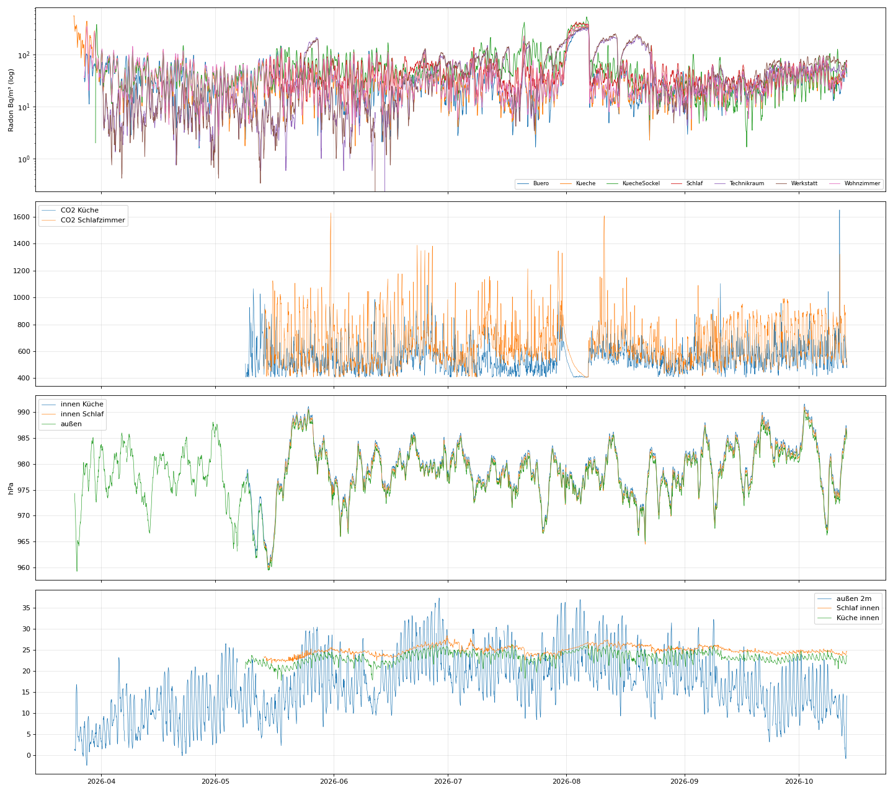
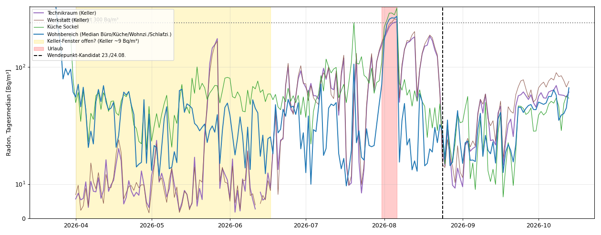
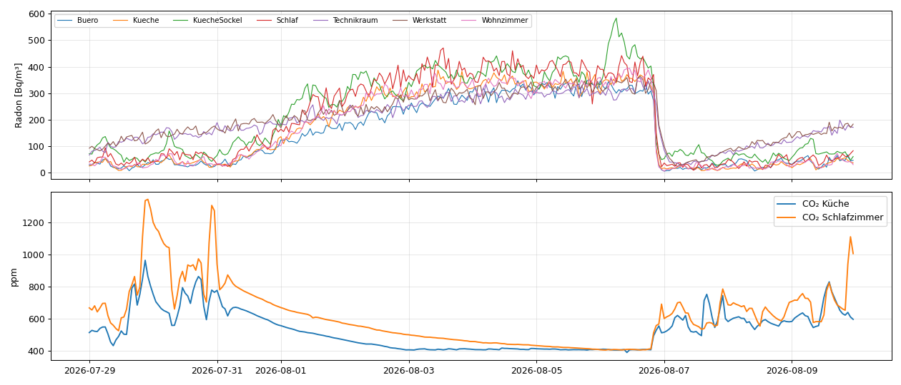
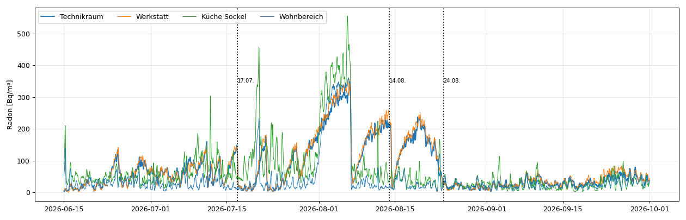

Alle Zahlen stammen aus den Skripten in `analyse/`. Radon in Bq/m³, Stunden- bzw. Tagesmedian, Zeiten in Ortszeit.
**Stand:** Hr. Grimmer hat Urlaub und Einbau-Datum bestätigt. Die Fenster-Hypothese wurde korrigiert (sporadisch statt fest zwei Fenster), siehe [Fragen und Antworten](fragen.qmd).
Eine einfache Version dieser Seite steht in [Einfach erklärt](einfach.qmd).

## Phasen im Überblick

| Phase | Zeitraum | Merkmal |
|---|---|---|
| A | 01.04.–17.06. | überwiegend gelüftet: Technikraum/Werkstatt sehr niedrig (Median 9), niedriger als Wohnbereich (26–39) |
| B | 18./22.06.–23.08. | Keller deutlich höher als Wohnbereich (Median 62 gegen 22–28), Sägezahn-Verlauf |
| Urlaub | 31.07. abends–06.08. | alle Räume 300–390, CO₂ flach (bestätigt) |
| D | 24.08.–22.09. | nach Einbau der Anlage: alle Räume ähnlich niedrig (18–30), Keller nicht mehr erhöht |
| E | ab 23.09. | alle Räume steigen leicht (Wohnbereich 34–45, Keller 50–65), laut Hr. Grimmer im Rahmen der Messgenauigkeit ±30 |

## 1. Urlaub (31.07. abends bis 06.08. gegen 19–20 Uhr)

- CO₂ in Küche und Schlafzimmer fällt auf etwa 405–415 ppm und bleibt flach (Tagesschwankung 10–15 ppm; sonst 400–1000+).
- Radon steigt in **allen** Räumen gleichzeitig auf 300–390 (Max: Schlafzimmer 502,6 am 03.08., Küche-Sockel 624 am 06.08.).
  Ohne Lüften und Bewohner baut sich Radon im ganzen Haus auf.
- Rückkehr am 06.08. gegen 19–20 Uhr: CO₂ springt hoch, Radon fällt innerhalb von etwa 2 Stunden von ~300 auf unter 25
  (Wohnbereich). Der Keller braucht länger (Technikraum 146 um 22 Uhr, 36 am 07.08. um 04 Uhr).
- Der Keller war schon vorher hoch (~190), der Urlaub erhöht ihn nur auf ~300.
- Einziger solcher Zeitraum im CO₂-Zeitraum (ab 08.05.). Mögliche frühere Abwesenheiten (März bis Anfang Mai) lassen sich ohne CO₂ nicht sicher erkennen.

## 2. Überwiegend gelüftete Zeit (01.04.–17.06.)

- Technikraum und Werkstatt laufen in dieser Zeit stark verdünnt: Tagesmedian um 9, Tiefstwerte 0–2, Verhältnis Keller/Wohnbereich meist 0,1–0,5.
  Danach ist der Keller höher als das Wohngeschoss. Das Muster passt zu viel Lüften im Keller. **Korrektur:** Hr. Grimmer sagt, die Fenster waren sporadisch und durcheinander offen, tendenziell mehr gelüftet als nicht. Die Annahme "immer zwei Fenster offen" gilt nicht.
- Die Nullwerte stützen das: 560 von 577 Nullen im Technikraum und 698 von 723 in der Werkstatt liegen in diesem Zeitraum,
  nur etwa 10 je Sensor stammen vom Sensorstart (Betriebszeit ≤ 10 min). Es sind also echte, sehr niedrige Messwerte.
- Statistisch beste Trennung in der Folgezeit: Technikraum 18.06. (7 → 42 Bq/m³), Werkstatt 22.06. (8 → 47). Der Übergang von "viel gelüftet" zu "weniger gelüftet" liegt also um den **18.–22.06.**, aber ohne festes Datum.
- Der **Beginn** ist offen: die Keller-Sensoren starten erst am 01.04., die Zeit davor ist nicht beurteilbar. Hr. Grimmer misst dem Keller wenig Gewicht zu.
- Unterbrechung 22.–27.05.: Keller steigt in sechs Tagen auf 232, fällt am 28.05. schlagartig. Laut Hr. Grimmer wurde länger nicht gelüftet und dann schlagartig gelüftet. Kleinere Anstiege 17.–19.04. und 01.–05.05.

## 3. Wendepunkt (Überdruck-Anlage): 24.08. (bestätigt)

- Vor dem Wendepunkt zeigt der Keller einen **Sägezahn**: mehrere Tage Anstieg auf 150–230, dann ein plötzlicher Absturz
  (17.07., 14.08. gegen 07–09 Uhr von 182 auf 24, 23.08.). Der Wohnbereich bleibt dabei unverändert, der Auslöser sitzt also im Keller (Tür, Fenster, Lüften).
- Nach dem **23./24.08.** bleibt der Keller einen Monat lang auf Wohnbereich-Niveau (Technikraum 24, Werkstatt 26) und baut sich nicht mehr auf.
  Der Sägezahn verschwindet. Die Küche-Sockel-Werte sinken schon ab etwa 17.08. (71 → 24).
- Rechnerisch (beste Einzel-Trennung der Tageswerte, Urlaub ausgeklammert): Technikraum und Werkstatt **23.08.** (76 → 31 und 83 → 36), Küche-Sockel **17.08.** (71 → 24).
- Die Differenz Innen-/Außendruck zeigt **keine Stufe** (0,7–1,4 hPa, vor allem Sensor-Offset und Wetter). Ein Überdruck von wenigen Pa
  ist mit diesen Sensoren nicht auflösbar, der Wendepunkt kommt also nur aus dem Radon-Verhalten.
- Ab etwa **23.09.** steigen alle Räume leicht (Büro 18 → 35, Wohnzimmer 21 → 39, Keller 50–65). Laut Hr. Grimmer liegt das innerhalb der Messgenauigkeit von ±30 Bq/m³ und ist nicht belastbar.
- Ob die Anlage geholfen hat, wird auf der Seite [Wirkung der Anlage](wirkung.qmd) ausgewertet.

## 4. Weitere Ausreißer und Ereignisse

Automatisch erkannt (Stundenwert über 3× gleitender 7-Tage-Median + 30 und über 100): 29 Ereignisse, Liste in `analyse/ereignisse_radon.csv`. Wichtigste:

| Zeitpunkt | Auffälligkeit |
|---|---|
| 20.07. 08 Uhr – 21.07. 00 Uhr | Alle Wohnräume steigen tagsüber auf 130–250 (Küche-Sockel 436), Keller nicht. CO₂ normal, also jemand zuhause. Laut Hr. Grimmer wahrscheinlich Fenster zu. |
| 11.07. 23 Uhr | Küche-Sockel 380, Büro/Küche/Wohnzimmer verdoppeln sich innerhalb 1 Stunde. Davor Schlafzimmer-CO₂ 1767 ppm (21:20). |
| 11.08. 20 Uhr | Küche-Sockel 351 in einer Stunde, dazu Schlafzimmer-CO₂ ~1050. |
| 23.08. 00–09 Uhr | Küche, Sockel, Schlafzimmer, Wohnzimmer 100–158, Büro nicht. |
| 28.03. 02–08 Uhr | Wohnzimmer 416 (Rohwert), Küche stündlich 470. Anlaufphase der Messung. |
| 24./25.03. | Küche startet bei 542–707 und fällt bis 27.03. auf ~136 (Sensor hatte beim ersten Wert erst 144 min Betriebszeit). |
| 30.03. 15–21 Uhr | Küche-Sockel 440 kurz nach Sensorstart (13:50), vermutlich Einlaufphase. |
| 11.10. | CO₂ Küche 1778 ppm um 17:11 (Höchstwert insgesamt), Küche-Sockel 214 um 01 Uhr. |
| 28.06. | Außentemperatur Maximum 37,4 °C (Minimum −2,5 °C am 28.03.). |

Viele kleinere Ereignisse (April–Juni) sind Nachtspitzen zwischen 01 und 08 Uhr in mehreren Räumen: normaler Tagesgang, nachts kein Lüften.

## 5. Datenqualität

- Messintervall etwa 10 min je Sensor; je Zeile meist nur ein Sensor, daher viele leere Felder und gleiche Zeitstempel.
- **Gleichzeitige Betriebszeit-Resets aller Sensoren** am 16.04. 07 Uhr, 30.04. 16 Uhr, 06.07. 06 Uhr, 30.08. 11 Uhr, 10.09. 14 Uhr und 16.09. 15 Uhr
  (Stromausfall oder Neustart des Servers/Hubs?). Einzel-Resets: Technikraum 13./14.06., Büro 12.08., Küche-Sockel 14.08., Küche 08./10./12.10.
- Die Betriebszeit springt dabei teils rückwärts und wieder vor (z. B. 28316 → 28285 → 0), die Zeilen stammen offenbar aus verzögert geschriebenen Puffern.
- **Datenlücken:** Technikraum/Werkstatt 11.06. 17:53 bis 13.06. (1 Tag 14 h), Werkstatt 27.08. 14 h, Büro 31.05. 8 h, Wohnzimmer 08.09. 5,7 h.
- Nullwerte nach Sensorstart (Betriebszeit ≤ 10 min) sind Einlaufartefakte (Büro 19, Küche 23, Sockel 19, Wohnzimmer 17).
- Der Schlafzimmer-Sensor liefert Dezimalwerte und keine Betriebszeit, ist also ein anderer Sensortyp. Wetterdaten nur stündlich, 11 Lücken über 2 h.
