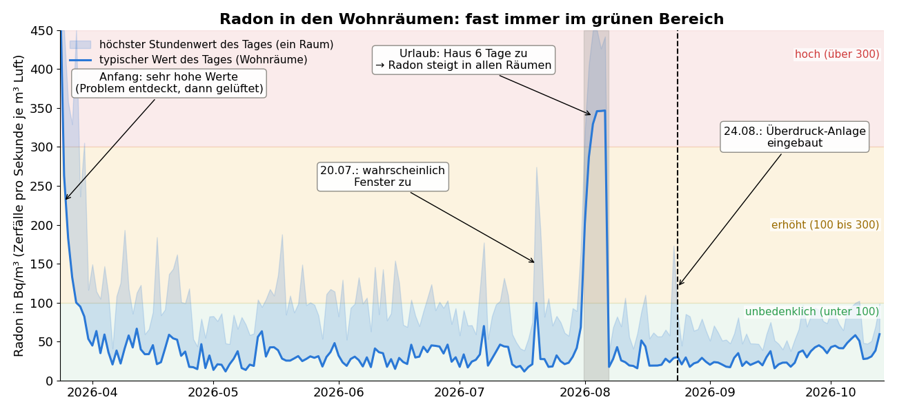
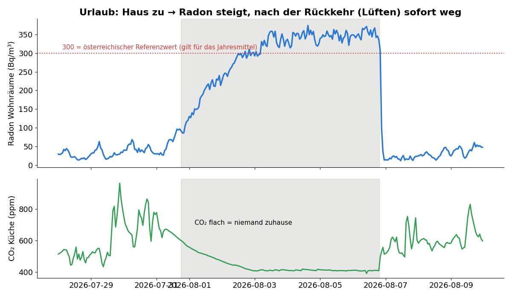
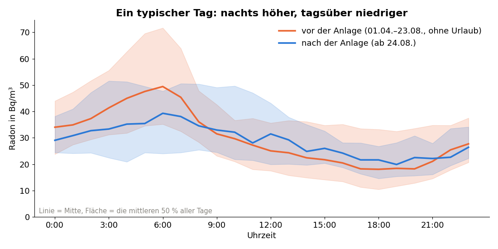
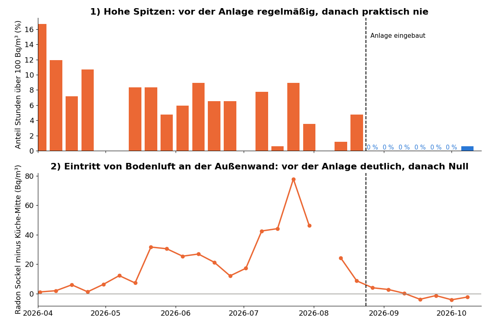

Diese Seite ist für alle, die sich mit dem Thema nicht auskennen. Du musst nichts vorher wissen.

## Worum geht es?

In einem Haus wurde ein Jahr lang (24.03. bis 13.10.2026) in mehreren Räumen **Radon** gemessen. Radon ist ein Gas, das aus dem Boden kommt, man sieht und riecht es nicht. Wer es über viele Jahre in hoher Menge einatmet, hat ein höheres Risiko für Lungenkrebs. Mitten im Zeitraum (24.08.) wurde eine Anlage eingebaut, die im Haus einen leichten Überdruck erzeugt. Dadurch soll weniger Bodenluft hereinkommen.

Wir wollen aus den Zahlen herauslesen: **Wann war etwas los? Warum? Und hat die Anlage etwas gebracht?**

## Das Mini-Lexikon

| Wort | Bedeutung |
|---|---|
| **Radon** | radioaktives Gas aus dem Boden. Geruchlos, unsichtbar. |
| **Bq/m³** (Becquerel pro Kubikmeter) | Maß für die Radon-Menge in der Luft. Je höher, desto mehr Radon. **Beispiel:** 30 Bq/m³ ist wenig, 300 ist viel. |
| **Referenzwert** | Richtwert, ab dem man etwas unternehmen soll: **100** (WHO) und **300** (Österreich). Er gilt für den **Durchschnitt über ein Jahr**, nicht für einzelne Stunden. |
| **CO₂** | Gas, das wir ausatmen. Hier ein "Anzeiger": steigt es, sind Menschen im Raum und die Luft ist verbraucht. Fällt es auf etwa 400, ist gelüftet worden oder niemand da. |
| **Überdruck-Anlage** | Gerät, das etwas mehr Luft in das Haus bläst als hinausgeht. So wird keine Bodenluft hereingesaugt. |
| **Messfehler ±30** | Der Sensor liegt um bis zu 30 Bq/m³ daneben. Unterschiede unter 30 sind nicht sicher. |

## So liest du die Bilder: die Ampel

Alle Radon-Diagramme haben eine "Ampel" im Hintergrund:

- **grün** (unter 100): unbedenklich
- **gelb** (100 bis 300): erhöht, bei kurzer Dauer nicht schlimm
- **rot** (über 300): hoch, sollte nicht lange so bleiben

Wichtig: Eine einzelne Stunde im roten Bereich ist kein Gesundheitsproblem. Entscheidend ist der Durchschnitt über sehr lange Zeit.

## Die Geschichte in sechs Schritten

**Was sieht man?** Die blaue Linie ist der typische Radonwert der Wohnräume je Tag. Sie bleibt fast immer im grünen Bereich. Es gibt zwei Ausreißer nach oben: ganz am Anfang und im Urlaub.

1. **Entdeckung (März):** Am Anfang zeigte der Küchen-Sensor 540 bis 700 Bq/m³. Das war der Moment, in dem das Problem erkannt wurde. Danach hat Hr. Grimmer etwas dagegen unternommen, der Wert fiel in wenigen Tagen stark.
2. **Alltag (April bis August):** Es wurde mal hier, mal da gelüftet, aber unregelmäßig. Radon lag meist bei **20 bis 40**. Nachts stieg es oft kurz auf 100 bis 200 (vermutlich bei geschlossenen Fenstern).
3. **Urlaub (31.07. bis 06.08.):** Niemand war zuhause, alles geschlossen. Das Radon stieg in **allen Räumen** auf etwa **330** (rund 15-mal mehr als sonst). Als der Bewohner zurückkam und lüftete, war es nach etwa **2 Stunden** wieder normal.
4. **Einbau der Anlage (24.08.):** Danach gab es praktisch keine Spitzen mehr (siehe unten).
5. **Herbst:** Die Werte steigen leicht (von etwa 22 auf 35 bis 40), liegen aber innerhalb des Messfehlers von ±30 und sind weiter im grünen Bereich.
6. **Fazit:** Die Anlage hilft gegen Spitzen und gegen Bodenluft an der Wand. Im Alltag war Radon schon vorher kaum ein Problem. Ausführlich: [Hat die Anlage geholfen?](wirkung.qmd)

**Was sieht man?** Die graue Fläche ist der Urlaub. Oben steigt Radon, unten ist das CO₂ flach (niemand atmet). Dann fällt Radon in kurzer Zeit auf fast Null, sobald gelüftet wird. **Was heißt das?** Ohne Lüften sammelt sich Radon an, Lüften wirkt sofort.

## Der typische Tag

**Was sieht man?** Für jede Uhrzeit ist der übliche Radonwert gezeigt (Mitte aller Tage). Die orange Linie ist die Zeit vor der Anlage, die blaue danach.

- Nachts (2 bis 7 Uhr) ist der Wert höher: vor der Anlage etwa **44**, danach **36**. Nachts sind die Fenster zu, die Luft steht.
- Tagsüber ist er niedriger (rund **22 bis 26**), weil gelüftet wird und Wind die Luft tauscht. Diese Erklärung ist die übliche Fachlogik (Allgemeinwissen, nicht aus den Quellen geprüft).
- Die **orange Fläche** reicht nachts weiter nach oben: Vor der Anlage gab es also an manchen Nächten deutlich höhere Werte. Danach liegt auch die obere Grenze niedriger (Mitte der oberen Hälfte der Tage: 63 gegen 50).

## Hat die Anlage geholfen?

- **Oben:** Anteil der Stunden mit mehr als 100 Bq/m³. Vor der Anlage in fast jeder Woche einige Prozent, danach **fast nie** (in 7 Wochen 1 Stunde).
- **Unten:** Vergleich zweier Sensoren im selben Raum, einer an der Außenwand am Boden, einer mitten im Raum. Ist der Wand-Sensor höher, kommt Bodenluft herein. Im Sommer war das so, **nach dem Einbau liegt der Unterschied bei null**.

**Antwort in einem Satz:** Die Anlage wirkt gegen Spitzen und Bodenluft, aber das Radon-Problem im Alltag war schon vorher klein. Das Dauer-Lüften nach dem Einbau war nicht nötig.

## Was wir nicht wissen

- Wie es im **Winter** aussieht (die Messung endet im Oktober, neue Daten gibt es laut Hr. Grimmer nicht).
- Was die Anlage bei einem **zweiten Urlaub** bringen würde.
- Welche **Stufe** der Anlage wann lief: Sie läuft durchgehend, aber mit wechselnder Luftmenge.
- Was die Anlage kostet (Anschaffung, Strom).
- Ob die Phasen stimmen, die wir aus den Daten gelesen haben: Hr. Grimmer hat sie teilweise bestätigt, siehe [Fragen und Antworten](fragen.qmd).

## Zum Weiterklicken

- [Dashboard](dashboard.html) zum Ausprobieren: Zeiträume und Räume wählen, Ereignisse anklicken.
- [Radon-Hintergrund](radon-hintergrund.qmd): warum Radon gefährlich ist und wie es ins Haus kommt.
- [Befunde](befunde.qmd): alle Zahlen im Detail für Fachleute.
