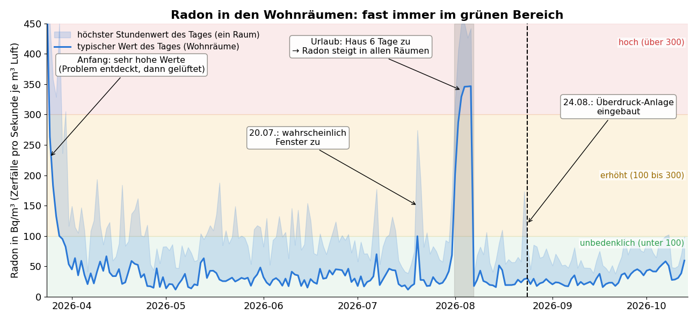
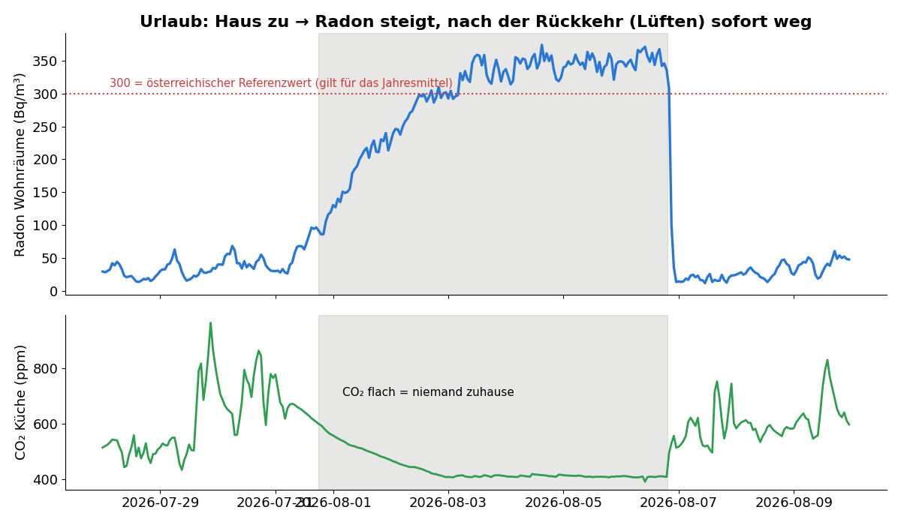
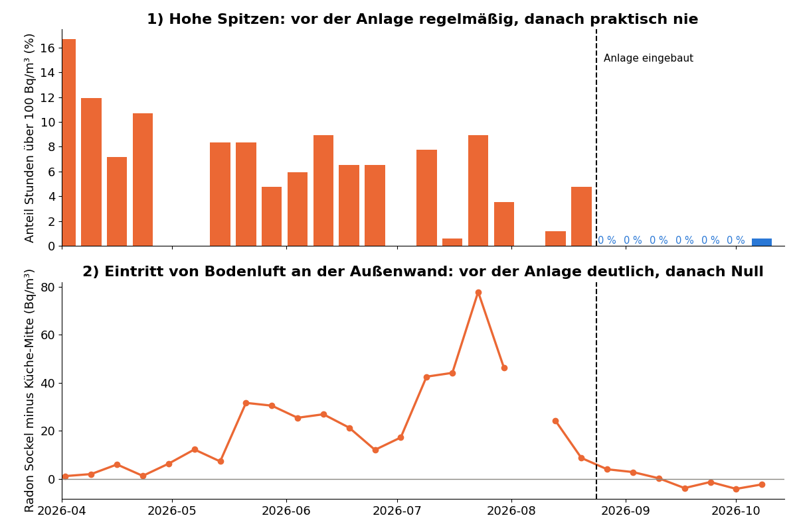

**Aufgabe von Hr. Grimmer:** Hat er mit der Anlage ein echtes Problem gelöst, oder hat er etwas unnötig bekämpft und dabei etwas verloren?

**Zusatzinfos von ihm:** Die Überdruck-Anlage wurde am 24.08. eingebaut. In den ersten Tagen danach hat er jedes Mal sofort gelüftet, wenn der Radonwert stieg, und die Fenster wieder geschlossen, sobald er fiel. Die Sensoren messen auf etwa ±30 Bq/m³ genau.

## Kurzantwort

**Teils, teils.**

1. **Ja, die Anlage wirkt.** Hohe Spitzen und die Bodenluft an der Außenwand sind nach dem Einbau verschwunden (Beweise unten).
2. **Das Problem war im Alltag aber klein.** Auch vor dem Einbau lagen die Wohnräume im Mittel bei etwa 36 Bq/m³. Das ist weit unter 100 (WHO) und 300 (Österreich). Über 300 ging es nur im Urlaub (Haus zu) und in den ersten Märztagen. Dazu kamen kurze nächtliche Spitzen zwischen 100 und 200 und am 20.07. (wahrscheinlich Fenster zu) bis etwa 250.
3. **Das Panik-Lüften nach dem Einbau war unnötig.** Die Werte, auf die er reagiert hat, waren harmlos und liegen zum Teil im Messfehler.
4. **Ob sich die Anlage insgesamt "lohnt", lässt sich mit diesen Daten nicht sagen.** Der Winter fehlt (dort ist Radon meist höher), und der entscheidende Test, ein längeres Wegfahren *mit* Anlage, wurde nicht gemacht. Auch die Kosten (Anschaffung, Strom, Heizwärme durch Lüften) stehen nicht in den Daten.

## Wie groß war das Problem wirklich?

| Frage | Antwort aus den Daten |
|---|---|
| Mittelwert der Wohnräume vor dem Einbau (ohne Urlaub) | 36 Bq/m³ |
| Mit dem Urlaub (Haus 6 Tage zu, ca. 330 Bq/m³) | 46 Bq/m³ |
| Referenzwerte (gelten für das Jahresmittel) | 100 (WHO), 300 (Österreich) |
| Stunden, in denen ein Wohnraum über 100 lag | 198 von 3334 (5,9 %) |
| Wann wurde es über 300? | nur im Urlaub und am Anfang im März (24.–30.03.) |
| Wann zwischen 100 und 300? | kurze Nachtspitzen (im Schnitt 117), 20.07. bis etwa 250 |

Der Urlaub zeigt das Prinzip: Ohne Lüften und ohne Menschen sammelt sich Radon im ganzen Haus. Nach der Rückkehr war es durch Lüften in etwa 2 Stunden wieder weg. Während des Urlaubs war niemand im Haus, die Belastung für Menschen war also gering.

Am Anfang (24.–30.03.) lag der Küchen-Sensor bei 540–700 Bq/m³. Das ist laut Hr. Grimmer der Moment, in dem er das Problem entdeckt und etwas dagegen getan hat. Wie lange es vorher so hoch war, steht nicht in den Daten.

## Was hat die Anlage verändert?

| Messgröße | Vor dem Einbau | Nach dem Einbau | Aussagekraft |
|---|---|---|---|
| Stunden mit Wert über 100 Bq/m³ in einem Wohnraum | 5,9 % (198 von 3334) | 0,1 % (1 von 1216) | **stark**: über 7 Wochen praktisch nie |
| Deutliche Spitzen (Wert verdoppelt sich, dann Absturz) | 12 in 14 Wochen (14.05.–23.08.), Spitzenwert im Mittel 117, höchstens 483 | 0 in 7 Wochen | **stark** |
| Sockel-Sensor minus Küchen-Sensor (Bodenluft an der Außenwand) | Median 19 Bq/m³, im Sommer bis 78 | Median 0 | **mittel**: der Rückgang begann schon ab Mitte August und die Jahreszeit spielt mit |
| "Normalwert" (Stunden unter 60) | 28 Bq/m³ | 29 Bq/m³ | **unverändert**: der Alltagswert war nie das Problem |
| Mittelwert Wohnräume gesamt | 36 Bq/m³ | 31 Bq/m³ | gering (unter dem Messfehler von ±30) |

**So liest man das:** Die Anlage drückt Radon nicht allgemein herunter, der Alltagswert blieb bei etwa 28. Sie kappt die **Spitzen** und stoppt den **Eintritt von Bodenluft an der Außenwand**. Der Sockel-Sensor steht an der Sockelleiste der Ost-Außenwand, der Küchen-Sensor mitten im Raum. Wenn der Sockel-Wert höher ist als die Raummitte, kommt Luft vom Boden herein. Das passierte vor dem Einbau, danach nicht mehr.

**Wichtig:** In der ersten Woche hat Hr. Grimmer bei jedem Anstieg gelüftet. Das allein kann Spitzen verhindern. Die Spitzenfreiheit in den **sechs Wochen danach** (ab 31.08., ohne Panik-Lüften) ist darum der bessere Beleg.

## Das Panik-Lüften: unnötig?

Ja, nach den Daten.

- In der Woche nach dem Einbau lag das Wohnraum-Mittel stündlich höchstens bei 57 Bq/m³, ein einzelner Raum erreichte bis etwa 86. Das sind Anstiege von rund +30 über den Normalwert, also **so groß wie der Messfehler** und weit unter 100.
- Selbst wenn diese kurzen Anstiege nicht weggelüftet worden wären, hätten sie den Mittelwert nur um etwa 2 Bq/m³ erhöht (31 mit gegenüber 29 ohne Stunden über 60).
- Das Lüften war kräftig: Das CO₂ in der Küche fiel in der Woche nach dem Einbau jeden Tag auf 408–435 ppm. Das entspricht etwa der Außenluft (Allgemeinwissen, nicht aus den Quellen geprüft). In den drei Wochen davor lag es nur bei 470–550 ppm. Im Mai bis Juli war er aber genauso fleißig. Das Lüften war also nicht ungewöhnlicher als im Frühling und Sommer.

## Was hat er "verloren"?

- **Wärme:** Im August und September kaum, im Winter wäre Lüften teuer. Heizdaten gibt es nicht, deshalb **nicht messbar**.
- **Kosten der Anlage** (Anschaffung, Strom): nicht in den Daten.
- **Nervosität und Zeit:** Das Dauer-Kontrollieren war wenig sinnvoll, die Anlage soll genau das ersetzen.
- **Aussagekraft der Messung:** Durch das Panik-Lüften in der ersten Woche lässt sich die reine Wirkung der Anlage für diese Tage nicht sauber ablesen.
- **Gewinn:** Spitzen weg, keine Bodenluft an der Außenwand, und er muss nicht mehr nach Zahlen lüften.

## Was die Daten nicht beantworten können

- **Winter:** Die Messung endet im Oktober. Radon ist im Winter meist höher (Allgemeinwissen). Ob die Anlage dann den Unterschied macht, ist offen.
- **Jahreszeit:** Der Vergleich vor/nach ist auch ein Vergleich Sommer/Herbst. Das Sockel-Signal sank schon vor dem 24.08.
- **Messfehler ±30 Bq/m³:** Der Anstieg im Herbst (Wohnräume im Wochenmedian von etwa 22 im September auf 35–42 Anfang Oktober) liegt in diesem Bereich und ist **nicht belastbar**. Der Sockel-Unterschied bleibt dabei bei etwa 0.
- **Der entscheidende Test fehlt:** Ein Wochenende oder Urlaub mit geschlossenen Fenstern *mit* Anlage. Im August (ohne Anlage) stieg das Haus auf über 300.
- **Keller:** Laut Hr. Grimmer weniger wichtig, deshalb nicht in die Bewertung eingegangen.
- **Einbau-Datum:** Ich gehe vom 24.08. aus. Am 23.08. nachts gab es eine Spitze in einigen Räumen, einen Tag vor dem Einbau (Ursache unbekannt).

## Vorschlag für die Abgabe

Antwort an Hr. Grimmer in einem Satz: *"Die Anlage entfernt Spitzen und Bodenluft-Eintritt zuverlässig, aber der Alltagswert war auch vorher unkritisch, und das Dauer-Lüften nach dem Einbau war nicht nötig. Ob sich die Anlage lohnt, entscheidet sich im Winter und beim nächsten Wegfahren."*

**Offene Fragen an ihn:** Läuft die Anlage seit dem 24.08. durchgehend? Wurde sie seitdem abgeschaltet oder verstellt? Gibt es Heiz- oder Stromdaten zum Vergleich? Wird im Winter weitergemessen?
